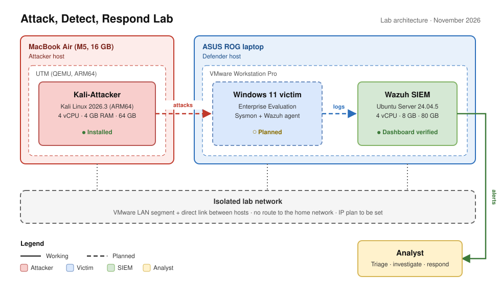
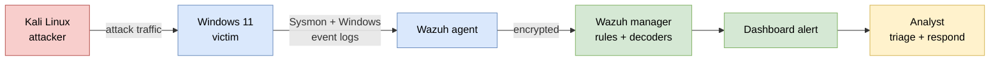

# Attack, Detect, Respond: Virtual Home Security Lab


I'm building a home security lab from scratch to practise the full defensive cycle: run an attack, catch it in a SIEM, respond to it, and write it up the way a SOC analyst would. Every step is documented here, including what broke and how I fixed it.

> **Status:** The first Windows-to-Wazuh exercise is complete. I verified event collection, tested a custom rule, and triaged the resulting alert. [Read the exercise write-up](docs/02-first-lab-exercise.md). Kali-based exercises are planned.



## How a detection works in this lab



## Progress

| # | Phase | Status | Write-up |
|---|---|---|---|
| 00 | Threat model and lab safety controls | Done | [00-threat-model.md](docs/00-threat-model.md) |
| 01 | Attacker VM: Kali Linux on Apple Silicon | Installed and updated | [01-attacker-setup.md](docs/01-attacker-setup.md) |
| 02 | SIEM server: Ubuntu Server + Wazuh | Operational | [First exercise](docs/02-first-lab-exercise.md) |
| 03 | VMware lab segment for Windows and Wazuh | Used for the first exercise | [First exercise](docs/02-first-lab-exercise.md) |
| 04 | Windows 11 + Sysmon + Wazuh agent | Active during the exercise | [First exercise](docs/02-first-lab-exercise.md) |
| 05 | First telemetry, detection, and triage exercise | Complete | [First exercise](docs/02-first-lab-exercise.md) |
| 06 | Attack exercises mapped to MITRE ATT&CK | Planned | [attack-scenarios.md](docs/attack-scenarios.md) |

## Planned attack coverage

| Technique | What it looks like | Detected? |
|---|---|---|
| T1046 Network Service Discovery | Nmap scan from Kali | Not yet run |
| T1110.001 Password Guessing | Hydra against SMB | Not yet run |
| T1078 Valid Accounts | Login after a successful guess | Not yet run |
| T1059.001 PowerShell | Remote commands over WinRM | Not yet run |
| T1136.001 Create Local Account | Backdoor user added | Not yet run |
| T1053.005 Scheduled Task | Persistence via `schtasks` | Not yet run |
| T1070.001 Clear Event Logs | `wevtutil cl` to hide tracks | Not yet run |

Full detail, including the Windows event IDs each one should produce, is in [attack-scenarios.md](docs/attack-scenarios.md). This table only changes when I've run the attack and have the alert to show for it.

## Repository layout

```
docs/          write-ups, threat model, attack plan, workflows
diagrams/      architecture diagram (SVG, plus the editable draw.io source)
screenshots/   evidence referenced from the write-ups
```

## Skills this lab covers

Virtualization (VMware, UTM/QEMU) · Linux administration · SIEM deployment (Wazuh) · Endpoint telemetry (Sysmon) · Threat modeling (STRIDE) · MITRE ATT&CK mapping · Incident response (NIST SP 800-61) · Network isolation · Technical documentation

## Ethics and scope

All testing runs only on machines I own, inside an isolated lab network. Nothing in this repository targets systems I don't own or have permission to test. The safety controls are in the [threat model](docs/00-threat-model.md).

---

Built and documented by [Stewart Ayim](https://github.com/ayimstewart) · CompTIA Security+ · AWS Solutions Architect – Associate
