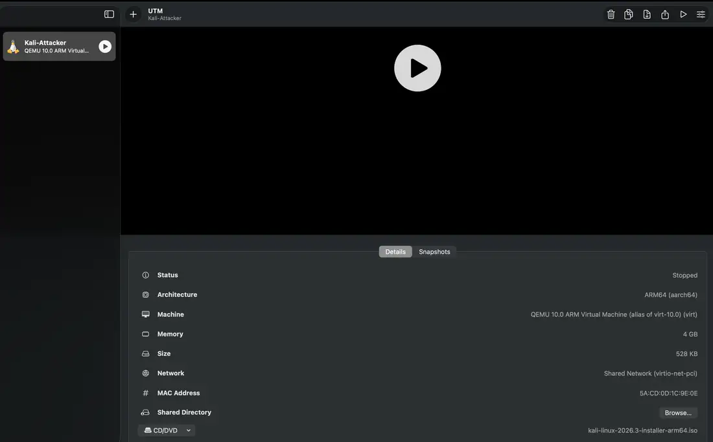
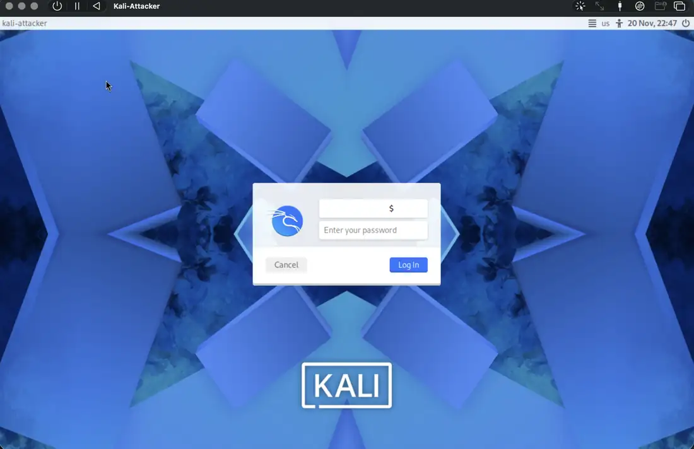
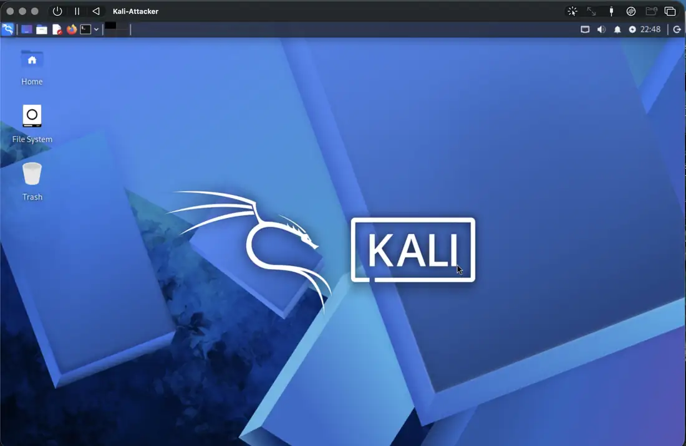
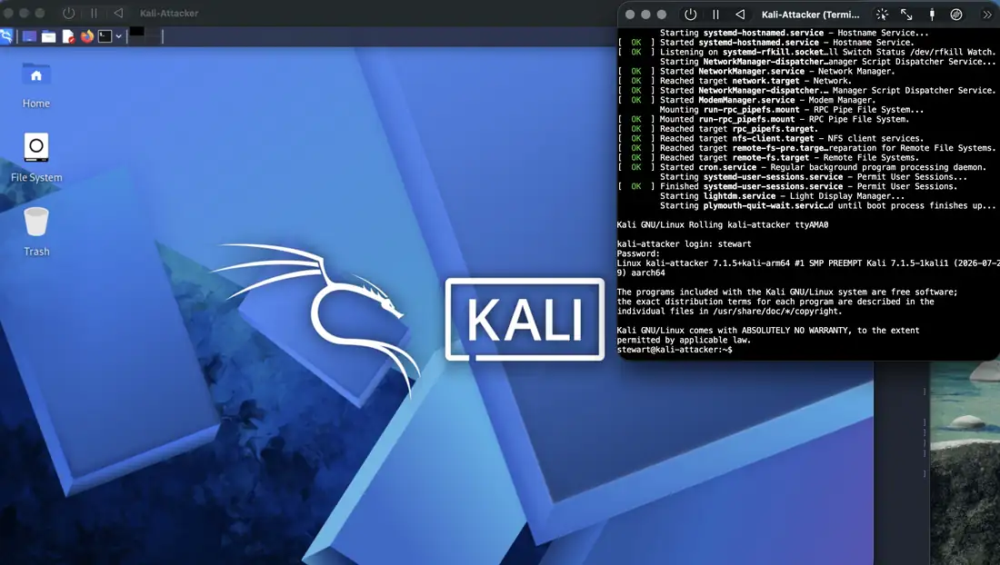

# 01: Attacker VM setup (Kali Linux on Apple Silicon)

**Date:** November 20, 2026
**Host:** MacBook Air, Apple M5, 16 GB RAM

The attacker side of the lab is a Kali Linux VM on my Mac. This page covers how I set it up, the two problems I hit, and how I fixed them.

## 1. VM configuration

I used UTM, a free hypervisor built on QEMU. It runs ARM64 guests natively on Apple Silicon, so Kali doesn't have to be emulated.

| Setting | Value | Why |
|---|---|---|
| Mode | Virtualize | Near-native speed on Apple Silicon |
| Architecture | ARM64 (aarch64) | Matches the M5 chip |
| Memory | 4 GB | Enough for the Kali desktop and tools, and the Mac stays usable |
| CPU cores | 4 | Leaves the rest for macOS |
| Disk | 64 GB | Room for tools, wordlists and logs. It only takes up space as it fills |
| Network | Shared Network (temporary) | Internet for install and updates only. It moves to the isolated lab network later |
| Installer | `kali-linux-2026.3-installer-arm64.iso` | Official ARM64 installer from kali.org |

## 2. Problem: the installer never showed up

On first boot the VM window showed a blinking cursor and nothing else. I could type, but the Kali boot menu never appeared.

The installer couldn't draw to UTM's default emulated display card, so the VM was running but I couldn't see its output.

What fixed it:
1. Changed the emulated display card to `virtio-ramfb`.
2. Added a serial device (UTM's built-in terminal) to the VM.
3. Restarted. The installer came up in the serial terminal and I finished the install from there.

Takeaway: a VM that looks frozen might just be sending its output somewhere you can't see. Check that before assuming it's broken.

## 3. Install choices

- Hostname: `kali-attacker`
- A standard user account (not root)
- Guided partitioning, whole disk, all files in one partition
- Kali's default software selection

## 4. Problem: it rebooted straight back into the installer

After the install finished, the VM rebooted into the installer again. The ISO was still attached, so the VM booted from it before the disk. I ejected the ISO in UTM (CD/DVD, then Clear) and the next boot went to the installed system.

## 5. Verification

- Graphical login screen and desktop both load
- Serial console login works as `stewart@kali-attacker`
- Kernel `7.1.5+kali-arm64`, architecture `aarch64`

Login screen:

Desktop:

Serial console login, showing the kernel and architecture:

## 6. Next steps

- [x] Update the system (`sudo apt update && sudo apt full-upgrade -y`)
- [ ] Record the version with `cat /etc/os-release`
- [ ] Take a clean UTM snapshot ("Clean install + updated")
- [ ] Move the VM from Shared Network to the isolated lab network
