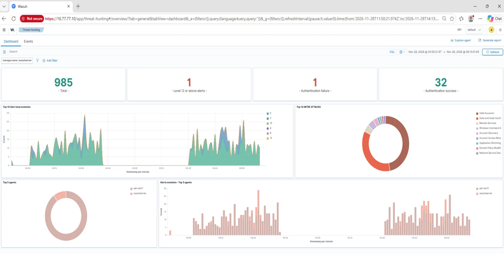
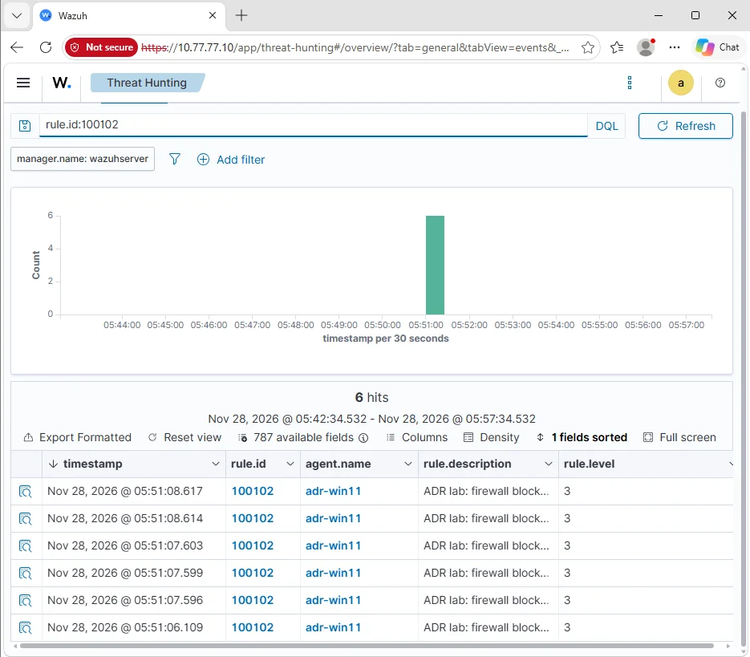
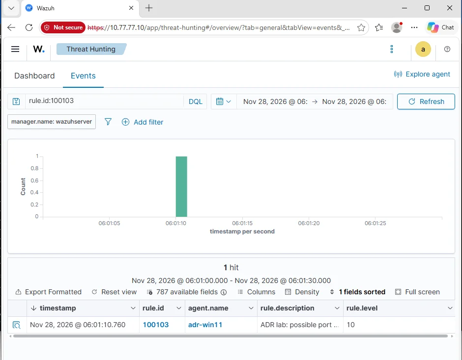

# Scenario 1: Network service discovery (MITRE T1046)

**Date:** November 28, 2026  
**Result:** Detected. Wazuh raised a level 10 "possible port scan" alert from my Windows 11 lab endpoint.

## What I tested

After verifying the Windows-to-Wazuh logging pipeline with a labeled local test (rule 100101), I ran a discovery scan from my Kali VM against the Windows 11 victim (adr-win11).
- Attacker: Kali Linux in UTM on my MacBook, on UTM's Shared Network. Because of that NAT, the victim saw the scan coming from my Mac's home Wi-Fi address, 192.168.1.89, not Kali's own address.
- Victim: adr-win11, with a temporary second network adapter bridged to my home Wi-Fi for the cross-machine test (192.168.1.102). Its first adapter stayed on the private ADR-Lab segment, so agent traffic to Wazuh never touched the home network.
- SIEM: Wazuh manager at 10.77.77.10, on ADR-Lab only.

The attack:

```
$ nmap -Pn -T4 -p 1-1000 192.168.1.102
```

All 1,000 ports came back filtered, because the Windows Firewall blocked them.

## What I changed

1. Turned on Windows Filtering Platform Connection failure auditing, so the firewall logs Security event 5157 for every blocked connection.
2. Removed the line in the Wazuh agent's config that was excluding 5157 from the Security log, so those events reach Wazuh.
3. Wrote two custom rules:
   - `100102` (level 3): one blocked inbound TCP connection (event 5157, protocol 6). It's a child of built-in rule 60104.
   - `100103` (level 10): 5 or more 100102 matches from the same source IP within 120 seconds. Tagged MITRE T1046.

## What went wrong and how I fixed it

**Problem 1: the rule never fired.** Windows was logging the 5157 events, but my rule produced zero alerts. Searching the raw alerts showed built-in rule 60104 ("Windows audit failure event") was already matching every 5157. Wazuh hands an event to the first child rule that matches, so my rule, a sibling under 60001, never got a turn. I made 100102 a child of 60104 instead, and it started matching.

**Problem 2: the threshold was too high.** The validation scan produced only 6 matches, all from 192.168.1.89 within about 2 seconds, across three destination ports: 445, 135 and 139, each hit twice. Windows only logs 5157 for ports with a service listening, so a 1,000-port scan of this VM shows up as 6 events. My first threshold was 8, so 100103 never fired. I lowered it to 5 matches from the same source within 120 seconds, based on that measured data.

On the next run, rule 100103 fired, and Threat Hunting returned one matching level 10 alert.

## Triage

I reviewed the alert and confirmed it as expected lab activity: the source IP, time and ports matched my controlled scan from Kali. No containment was needed.

Along the way I also filtered out home-network noise. Another device (192.168.1.69) was sending SSDP traffic (UDP port 1900) that Windows also blocked and logged. My rule only counts TCP, so that noise doesn't trigger it.

## Limitation

The rule counts blocked connections, not distinct ports. Repeated attempts against a single port, such as a machine retrying SMB five times within two minutes, could also trigger it. Ways to improve it: count distinct destination ports, or audit event 5152 (packet drop) so probes to closed ports are logged too.

## Evidence

**Today's dashboard, after the test scans**



**Six 100102 matches from 192.168.1.89, across ports 445, 135 and 139**



**The rule 100103 level 10 alert**


