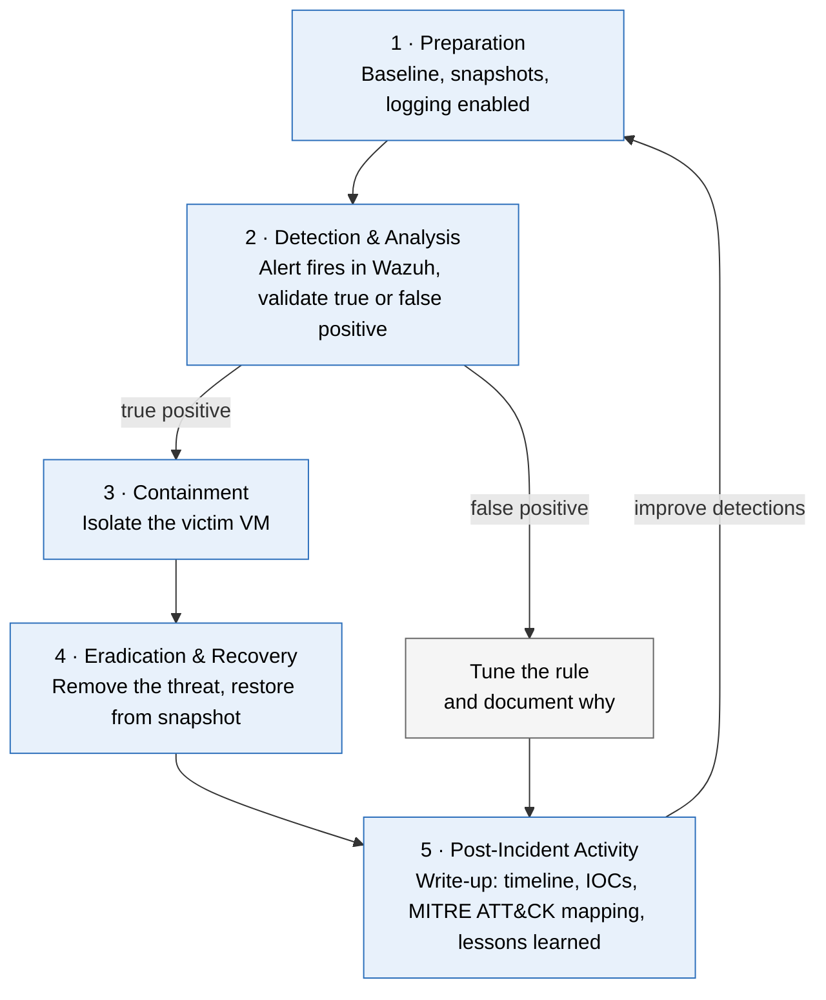

# Lab Workflows

Diagrams written as code in [Mermaid](https://mermaid.js.org/). GitHub renders them automatically, and they live in version control next to the lab they describe.

## 1. Detection pipeline

How a single attack becomes an alert I can investigate.

```mermaid
flowchart LR
    A["🗡️ Kali Linux<br/>Attacker"] -->|"attack traffic"| B["🪟 Windows 11<br/>Victim"]
    B -->|"process, network,<br/>logon events"| C["Sysmon<br/>+ Windows Event Log"]
    C -->|"Wazuh agent<br/>(encrypted)"| D["🛡️ Wazuh Manager<br/>Rules + decoders"]
    D -->|"indexed alerts"| E["📊 Wazuh Dashboard"]
    E --> F["👤 Analyst<br/>Triage + respond"]

    classDef attacker fill:#F8CECC,stroke:#B85450,color:#000
    classDef victim fill:#DAE8FC,stroke:#6C8EBF,color:#000
    classDef siem fill:#D5E8D4,stroke:#82B366,color:#000
    classDef analyst fill:#FFF2CC,stroke:#D6B656,color:#000
    class A attacker
    class B,C victim
    class D,E siem
    class F analyst
```

## 2. Incident response workflow

Each attack exercise in this lab is handled following the incident response phases in **NIST SP 800-61**.

